<div align="center">

<a href="https://codewithevilxd.github.io/pippo/">
  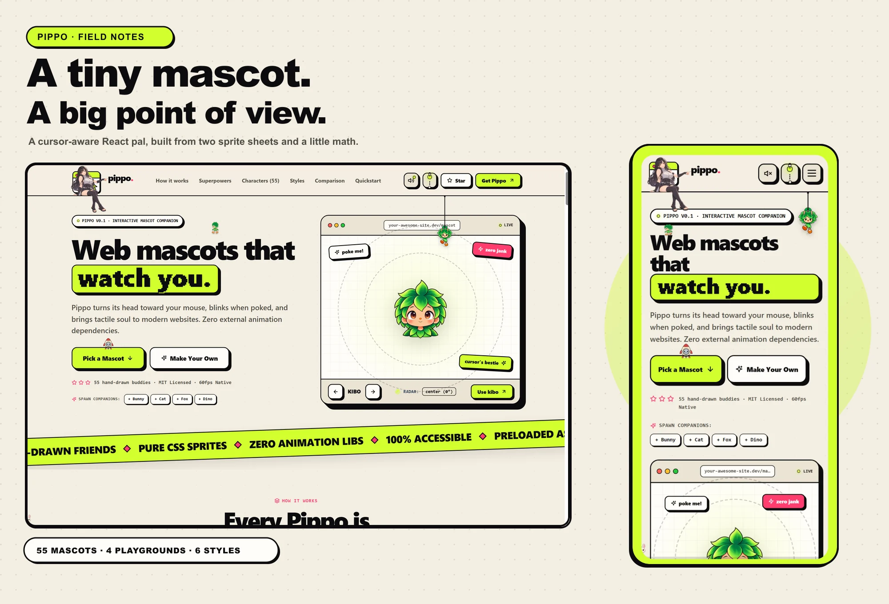
</a>

<br />

### A little pal for your page. A lot of personality for your visitors.

Pippo is a tiny React mascot that looks toward the pointer, reacts to a click, and settles back in place. Give it two sprite sheets and a home in your layout.

[](https://www.npmjs.com/package/pippo-mascot)
[](https://react.dev/)
[](https://www.typescriptlang.org/)
[](./LICENSE)

<br />

[Try the live playground](https://codewithevilxd.github.io/pippo/) · [View the npm package](https://www.npmjs.com/package/pippo-mascot) · [Read the component source](./src/pippo.tsx)

</div>

---

## Take a look around

The cover above is assembled from fresh desktop and phone captures of the real site. Here are a few more corners of Pippo’s little world:

<p align="center">
  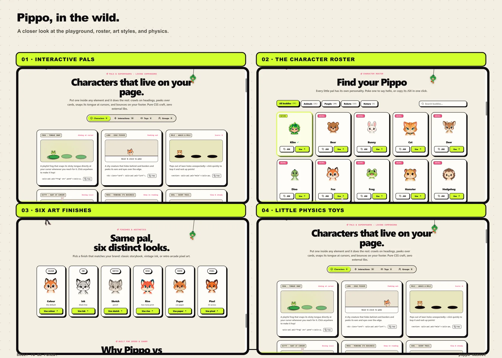
</p>

<details>
<summary><strong>Open the screenshot gallery</strong></summary>

<br />

| Warm paper | Night mode |
|:---:|:---:|
| 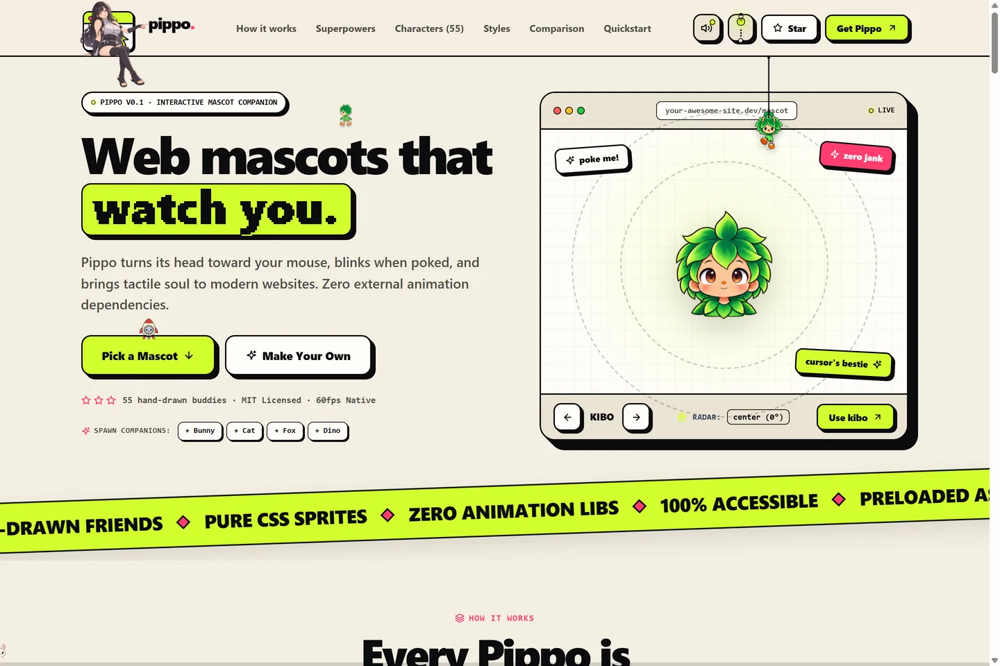 | 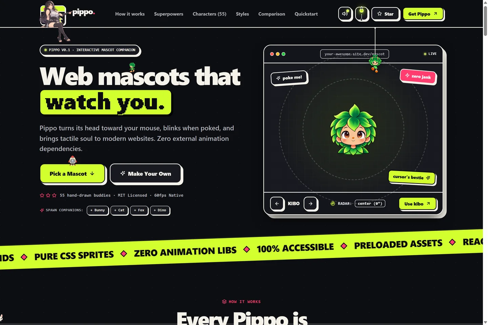 |

| A closer look at the layers | Mascot playground |
|:---:|:---:|
| 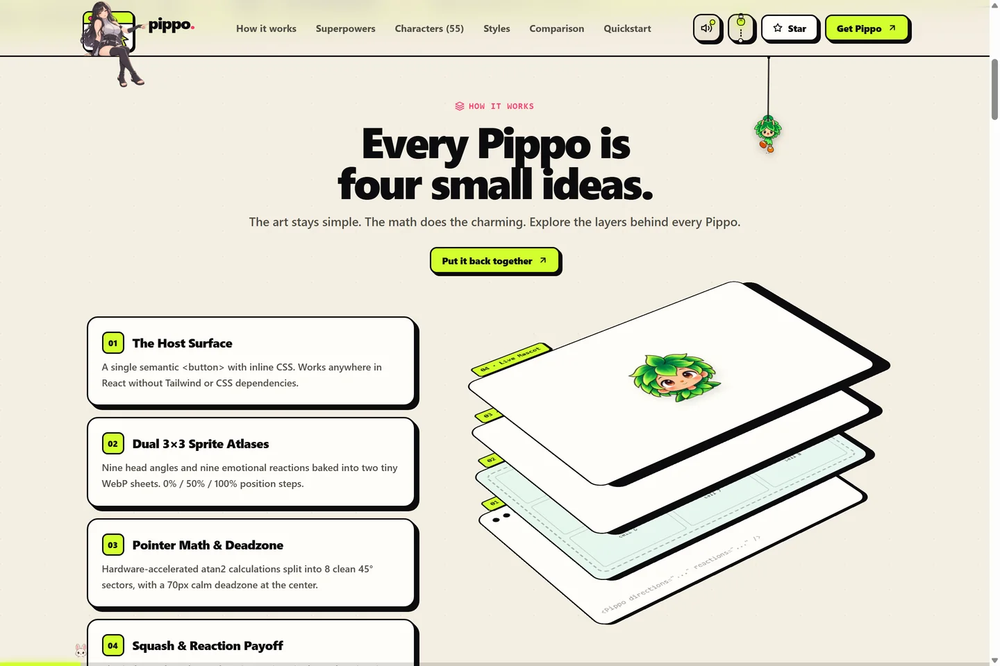 |  |

| Interactions | Toy physics |
|:---:|:---:|
| 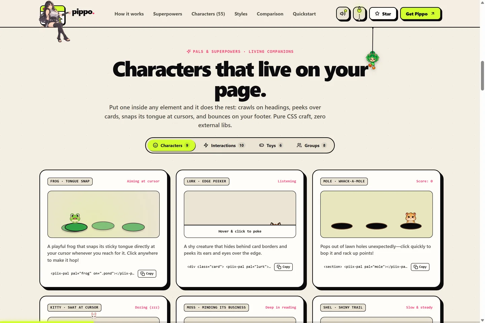 | 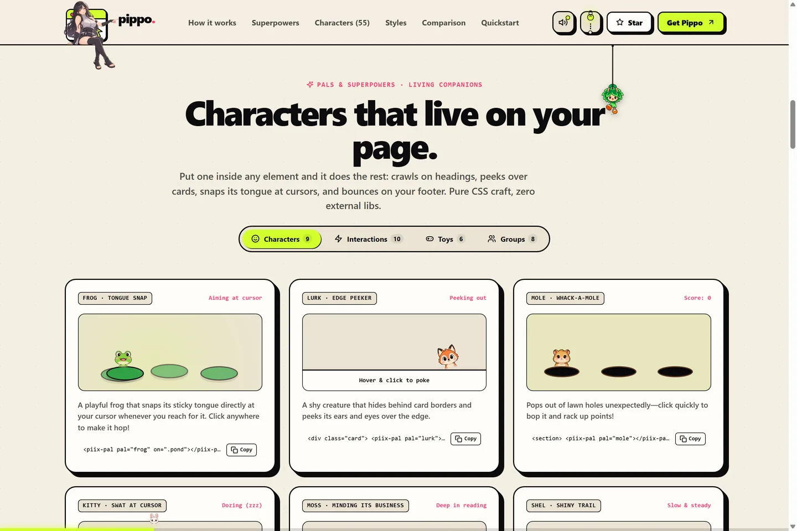 |

| Groups and flocks | Find a pal |
|:---:|:---:|
|  | 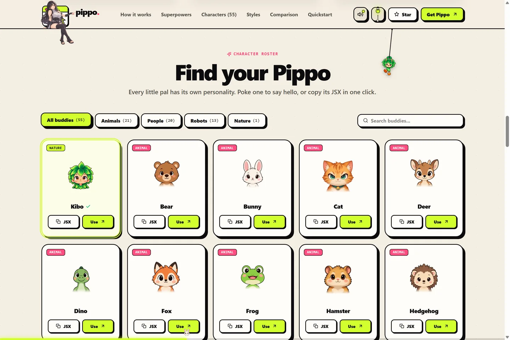 |

| Six finishes | Small-screen layout |
|:---:|:---:|
| 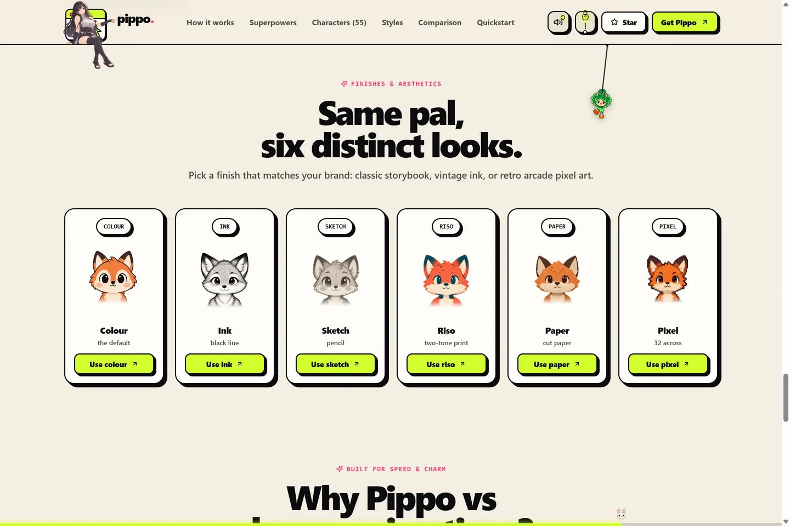 | 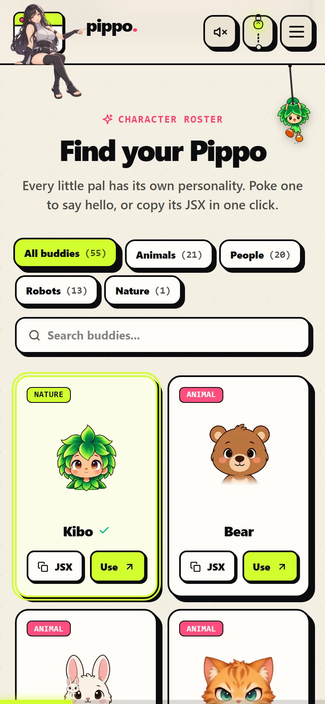 |

<p align="center">
  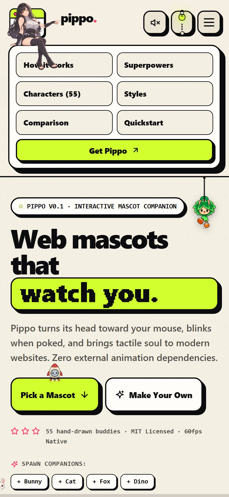
  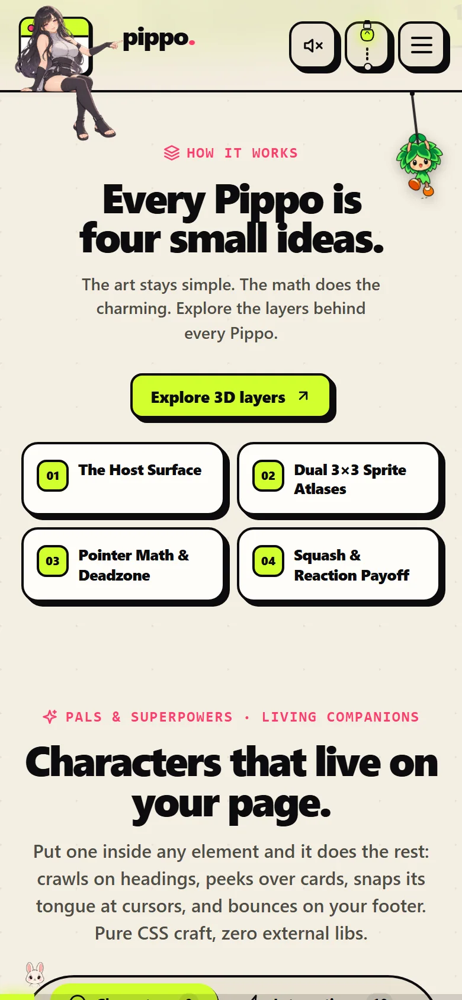
  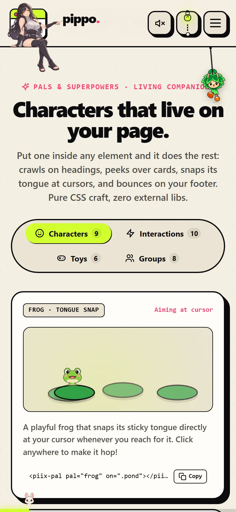
  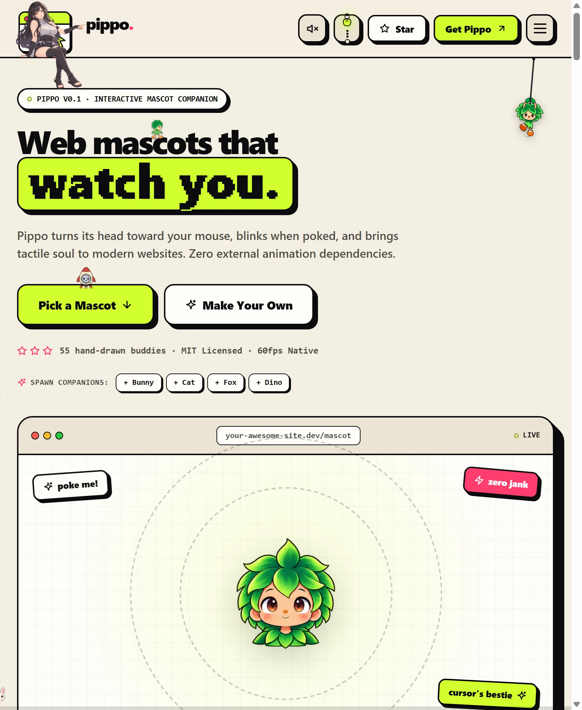
</p>

</details>

---

## What Pippo does

- **Looks around.** The pointer selects one of eight directions; a small centre dead zone keeps the mascot calm when the cursor is close.
- **Reacts to a poke.** Click or tap for a blink, a little payoff, and a springy squash. Repeated clicks can trigger a dizzy face.
- **Stays lightweight.** Two CSS sprite layers do the drawing. No canvas, animation framework, or added runtime package is needed.
- **Fits into your UI.** It is a real, labelled `<button>` with inline styles, so you can place it in a header, card, empty state, or anywhere else in your React layout.
- **Respects the device.** Cursor tracking is only enabled for a fine hover pointer. The squash animation respects `prefers-reduced-motion`.

The component is the animation engine; the character sheets are separate image files that you serve from your app. That keeps the component small and lets you use your own art, too.

---

## Add a mascot to a React app

### 1. Install

```bash
npm install pippo-mascot
```

Pippo works with React 18 and newer. React is a peer dependency; there are no additional runtime dependencies.

### 2. Get two sprite sheets

Choose a character in the [live roster](https://codewithevilxd.github.io/pippo/#characters), then download its **directions** and **reactions** sheets into your app’s public assets. For example, the fox sheets are:

- [fox-directions.webp](https://codewithevilxd.github.io/pippo/sprites/fox-directions.webp)
- [fox-reactions.webp](https://codewithevilxd.github.io/pippo/sprites/fox-reactions.webp)

Put them in `public/sprites/` (or another folder your app serves). The image paths below should point to the files from the browser’s point of view.

### 3. Render it

```tsx
import { Pippo } from 'pippo-mascot'

export function Welcome() {
  return (
    <header className="welcome">
      <h1>Make yourself at home.</h1>
      <Pippo
        directions="/sprites/fox-directions.webp"
        reactions="/sprites/fox-reactions.webp"
        size={120}
        label="Foxy"
      />
    </header>
  )
}
```

In Next.js App Router, render Pippo from a Client Component by adding `'use client'` at the top of that file.

<details>
<summary><strong>How the two sprite sheets work</strong></summary>

<br />

Each sheet is a 3 × 3 atlas. The first contains eight gaze directions and a centred pose; the second contains nine expressions. Pippo switches cells with CSS `background-position` and keeps both sheets mounted so a reaction image is ready when clicked.

<p align="center">
  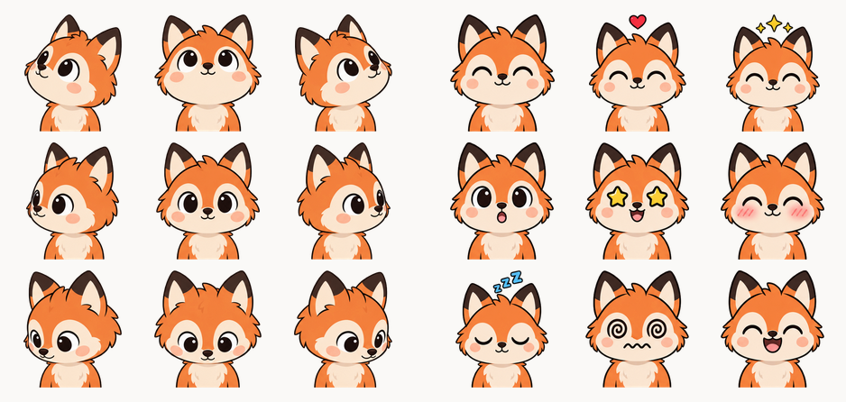
</p>

</details>

### Component props

| Prop | Type | Required | Default | What it controls |
|---|---|:---:|---|---|
| `directions` | `string` | Yes | — | URL or imported asset for the 3 × 3 direction sheet. |
| `reactions` | `string` | Yes | — | URL or imported asset for the 3 × 3 expression sheet. |
| `size` | `number` | No | `140` | Width and height in CSS pixels. |
| `label` | `string` | No | `Pippo` | Accessible name used by the button. |
| `className` | `string` | No | — | Class added to the button for your layout styles. |

---

## A whole playground to explore

The demo site goes beyond the npm component. It has a roster of **55 ready-to-use characters**—21 animals, 20 people, 13 robots, and Kibo from nature—plus four interactive playground tabs and six fox art finishes.

Try the frog that snaps its tongue at your cursor, a shy card peeker, a whack-a-mole, a draggable jelly, small flocks, and more. On phones, the examples open progressively so the page stays easy to browse.

<p align="center">
  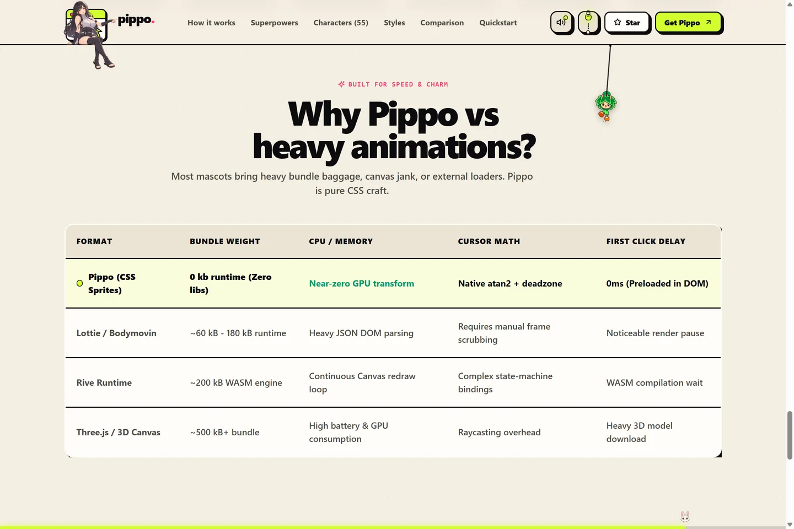
</p>

**Explore:** [characters](https://codewithevilxd.github.io/pippo/#characters) · [superpowers](https://codewithevilxd.github.io/pippo/#play) · [art finishes](https://codewithevilxd.github.io/pippo/#styles) · [quickstart](https://codewithevilxd.github.io/pippo/#quickstart)

---

## Make a new character

This repository also includes the **Pippo skill** for an AI coding agent. It can create a pair of sprite sheets, align the poses, verify the result, and show how to put the character on a page.

```bash
npx skills add codewithevilxd/pippo --skill pippo --global --yes
```

Then ask your agent, for example:

```text
/pippo a sleepy chibi red panda with a tiny scarf
```

Creating original artwork requires an image-generation tool. The API workflow can use `OPENAI_API_KEY`; building and checking the sprite sheets uses the Python dependencies listed in [`skills/pippo/scripts/requirements.txt`](./skills/pippo/scripts/requirements.txt). See [`skills/pippo/SKILL.md`](./skills/pippo/SKILL.md) for the full workflow and [`character-prompts.md`](./skills/pippo/reference/character-prompts.md) for the art direction.

---

## Develop Pippo

```bash
npm install
npm run dev          # local showcase at http://localhost:5173/pippo/
npm run typecheck
npm run lint
npm run build        # package files in dist/
npm run build:site   # static showcase in site-build/pippo/
```

The npm package is built from `src/`. The interactive showcase lives in `site/`. `npm run deploy` builds the showcase and deploys the static assets using Wrangler.

```text
src/                    React component published to npm
public/sprites/         Ready-to-use character sheets served by the showcase
site/                   Interactive demo website
skills/pippo/           Character creation and sprite-sheet workflow
.github/media/          README screenshots and visual previews
```

## Contributing

Bug reports, accessibility improvements, new characters, and new playground ideas are welcome. Open an issue or send a pull request.

## License

The project is released under the [MIT License](./LICENSE).

<div align="center">

<br />

**Give Pippo a little boop.**

[Open the playground →](https://codewithevilxd.github.io/pippo/)

</div>
